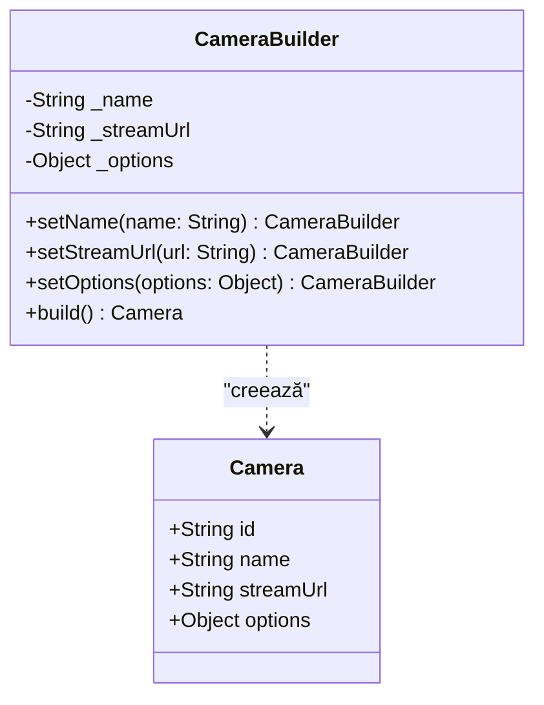
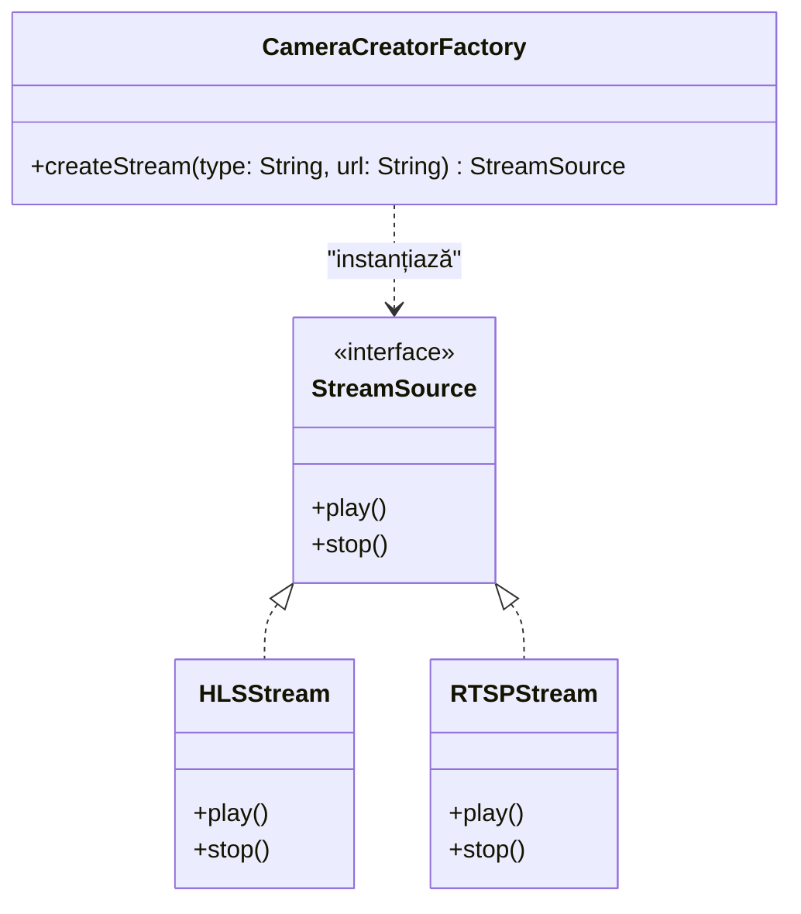
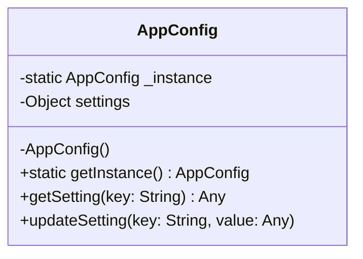

# Live Stream Sight

Dashboard web pentru supraveghere video a unei locații, cu suport pentru camere IP/Hikvision, convertite din RTSP în HLS. 
Proiect universitar în care aplicația a fost refactorizată pe principiile OOP (SOLID și Design Patterns) pentru disciplina TMPS.

## Funcționalități
* Grilă cu camere, căutare după nume sau locație, indicator Live/Offline.
* Viewere fullscreen cu sunet pentru o cameră.
* Control de înregistrare per cameră: Auto (declanșat de mișcare), sau Manual.
* Fallback pe placeholder când camera e offline, nu are URL sau returnează eroare.

---

## Laboratorul 1: Principiile SOLID

În cadrul primului laborator, arhitectura aplicației a fost structurată pentru a respecta cele 5 principii SOLID:

* **S (Single Responsibility Principle):** Fiecare modul/componentă are o singură responsabilitate. De exemplu, `CameraTile` se ocupă exclusiv de afișare UI, în timp ce logica de streaming video a fost extrasă în hook-ul `use-video-stream`.
* **O (Open/Closed Principle):** Componentele sunt deschise pentru extindere, dar închise pentru modificare. Modulul de redare acceptă noi tipuri de stream-uri fără a modifica codul de bază al componentelor.
* **L (Liskov Substitution Principle):** Interfețele definite pentru sursele video permit interschimbarea oricărui tip de stream (HLS, RTSP) fără a "sparge" aplicația.
* **I (Interface Segregation Principle):** Interfețele definite în `types.ts` sunt mici, clare și specifice nevoilor fiecărei componente, evitând obiectele masive.
* **D (Dependency Inversion Principle):** Logica de nivel înalt (componentele React) se bazează pe abstracții și interfețe, nu pe implementări concrete de nivel scăzut.

---

## Laboratorul 2: Design Patterns

Acest capitol detaliază implementarea a trei Design Patterns (Builder, Factory Method, Singleton) adaptate la structura modulară a limbajului TypeScript.

### 1. Builder Pattern
**Scop:** Separarea logicii complexe de creare a unui obiect de reprezentarea sa finală, permițând asamblarea treptată. Este deosebit de util când un obiect necesită numeroși parametri opționali de configurare.

**Implementare în proiect:** `src/lib/camera/camera-builder.ts`
* Clasa `CameraBuilder` permite configurarea detaliilor unei camere video (nume, URL stream, setări de autentificare) secvențial, înainte de a apela metoda `build()` pentru a returna obiectul final de tip `Camera`.

### 2. Factory Method (Creator Pattern)
**Scop:** Definește o interfață pentru crearea unui obiect, dar deleagă responsabilitatea instanțierii propriu-zise către subclase sau module specializate.

**Implementare în proiect:** `src/lib/camera/camera-creator.ts`
* Funcția de tip *Factory* primește parametri generici și decide intern ce tip exact de sursă video trebuie inițializată în funcție de input (ex: un stream HLS vs. RTSP).

### 3. Singleton Pattern
**Scop:** Garantează că o clasă (sau un modul) are o singură instanță pe parcursul întregului ciclu de viață al aplicației și oferă un punct global de acces la aceasta.

**Implementare în proiect:** `src/lib/config/app-config.ts`
* Setările globale ale aplicației sunt stocate într-o singură instanță. Orice componentă primește exact aceeași instanță de configurare din memorie, prevenind inconsistențele.

