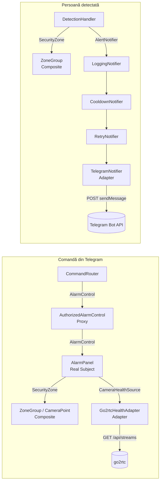
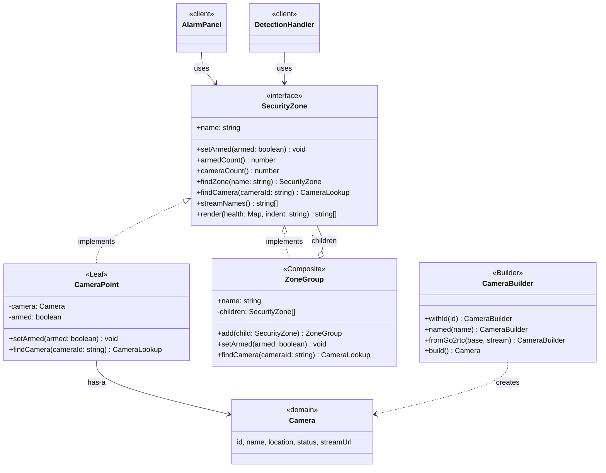
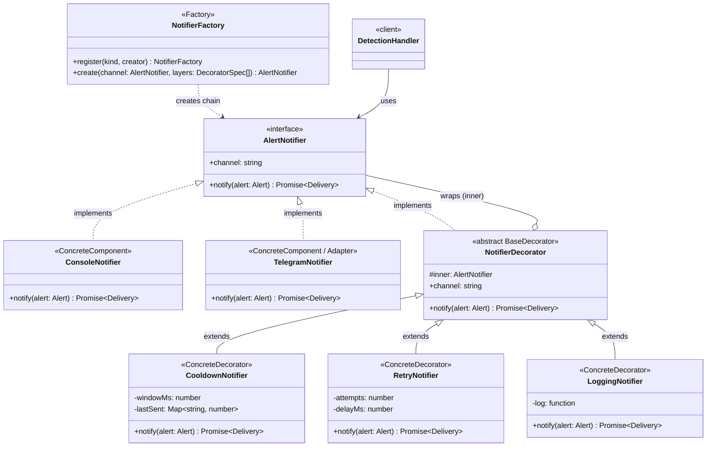
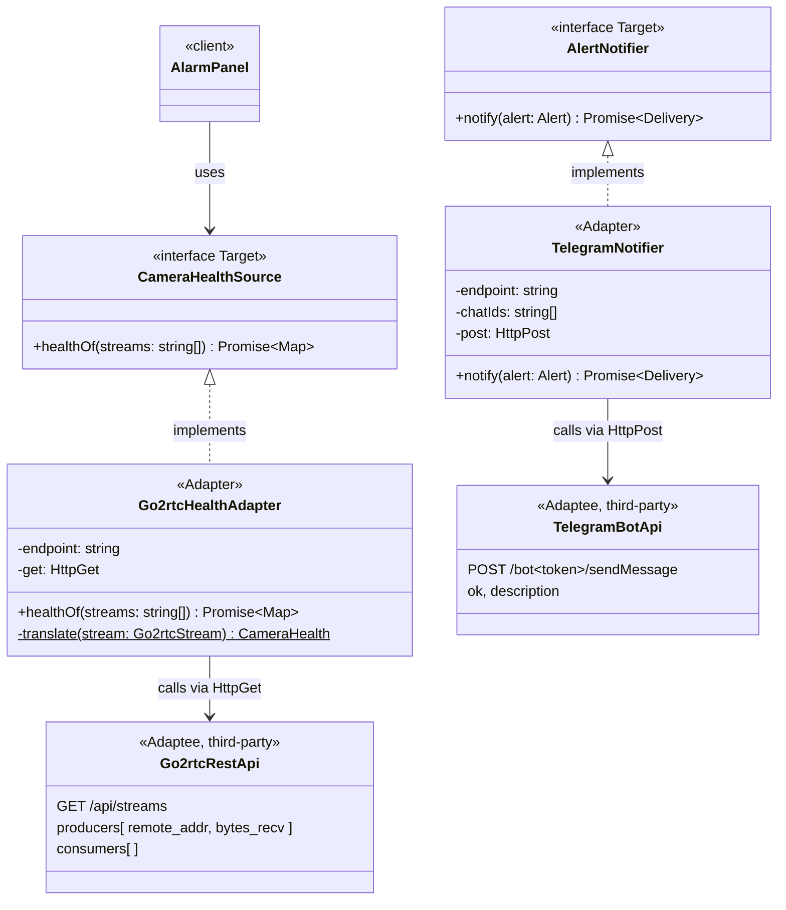
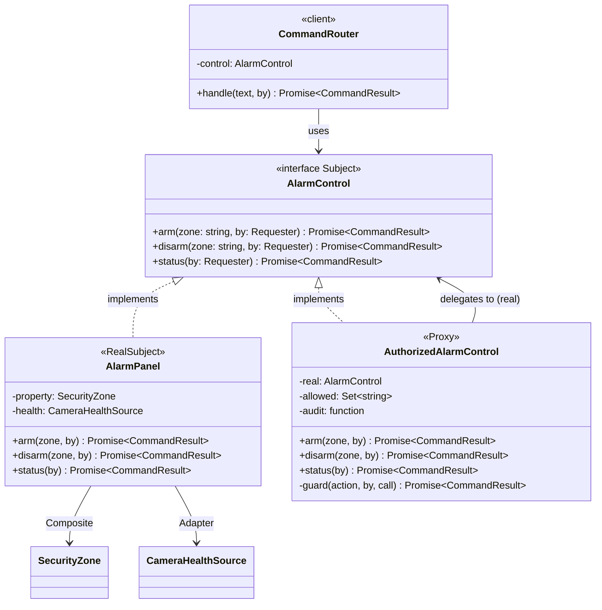

# Raport: Laboratorul nr. 2: Pattern-uri structurale

**Student:** Strunga Daniel-Ioan, FAF-242
**Proiect:** Live Stream Sight, sistemul de securitate al casei (TypeScript)
**Cod:** [`src/security/`](src/security/) · **Teste:** [`test/patterns/`](test/patterns/) · **Demo:** `npm run demo`

## 1. Descrierea domeniului

Live Stream Sight este aplicația de supraveghere a casei. Patru camere Hikvision trimit imaginea prin
[go2rtc](https://github.com/AlexxIT/go2rtc), care o convertește din RTSP pentru browser. Un detector de
persoane (YOLO) urmărește camerele, iar când vede pe cineva lângă o cameră armată trimite o alertă pe
Telegram. Tot din Telegram, proprietarul armează sau dezarmează o zonă (curtea, casa sau toată
proprietatea) și cere starea camerelor.

În acest laborator am adăugat aplicației un strat de domeniu pentru aceste funcții, cu patru pattern-uri
structurale. Fiecare rezolvă o problemă reală a sistemului:

| Pattern | Problema rezolvată în proiect |
|---|---|
| **Composite** | O cameră, o zonă (Curte, Casă) și toată proprietatea se armează, se numără și se afișează la fel, fără `instanceof`. |
| **Decorator** | Canalul de alertă trebuie să nu trimită spam (cooldown), să reîncerce când rețeaua cade (retry) și să lase urme în log (logging), în orice combinație. |
| **Adapter** | Două API-uri pe care nu le-am scris: REST-ul go2rtc (descrie *conexiuni*, nu *camere*) și Telegram Bot API (are formatul lui de cerere și răspuns). |
| **Proxy** | Oricine poate găsi un bot de Telegram și îi poate scrie, dar doar utilizatorii permiși pot arma sau dezarma. |

**Bazat pe laboratorul de pattern-uri creaționale:** obiectele cu care lucrează pattern-urile structurale
sunt create de pattern-uri creaționale:
- [`CameraBuilder`](src/security/creational/camera-builder.ts) (**Builder**) construiește camerele (frunzele Composite-ului);
- [`NotifierFactory`](src/security/creational/notifier-factory.ts) (**Factory**) construiește lanțul de decoratori dintr-o politică.

### Structura proiectului

```
src/security/
  domain/        modele: Alert, Delivery, CameraHealth           (fără pattern-uri)
  creational/    CameraBuilder, NotifierFactory                  (Builder, Factory)
  patterns/
    composite/   SecurityZone, CameraPoint, ZoneGroup
    decorator/   AlertNotifier, ConsoleNotifier, NotifierDecorator,
                 CooldownNotifier, RetryNotifier, LoggingNotifier
    adapter/     CameraHealthSource, Go2rtcHealthAdapter, TelegramNotifier, http
    proxy/       AlarmControl, AlarmPanel, AuthorizedAlarmControl
  client/        CommandRouter, DetectionHandler (clienți), setup.ts (composition root), demo.ts
test/patterns/   câte un fișier de teste pentru fiecare pattern + integration.test.ts
```

### Cum interacționează pattern-urile

Două fluxuri ale aplicației trec prin mai multe pattern-uri:



Clienții (`CommandRouter`, `DetectionHandler`) primesc doar interfețe: `AlarmControl`, `SecurityZone`,
`AlertNotifier`. Clasele concrete sunt numite într-un singur loc,
[`client/setup.ts`](src/security/client/setup.ts) (composition root).

---

## 2. Pattern-urile

### 2.1 Composite: zonele de securitate

**Problema:** proprietatea este un arbore: Proprietate → {Curte → {Poarta, Curtea din spate},
Casă → {Intrare, Garaj}}. Comanda „dezarmează Casa” și „dezarmează tot” trebuie să meargă la fel,
iar starea trebuie afișată pe niveluri, cu numărul de camere armate din fiecare zonă.



**Cod** ([`patterns/composite/zone-group.ts`](src/security/patterns/composite/zone-group.ts#L23-L58)):

```ts
export class ZoneGroup implements SecurityZone {
  readonly name: string;
  private readonly children: SecurityZone[] = [];

  setArmed(armed: boolean): void {
    for (const child of this.children) child.setArmed(armed);
  }

  armedCount(): number {
    return this.children.reduce((sum, c) => sum + c.armedCount(), 0);
  }

  findCamera(cameraId: string): CameraLookup | undefined {
    for (const child of this.children) {
      const found = child.findCamera(cameraId);
      if (found) return { ...found, zone: found.zone ? `${this.name} › ${found.zone}` : this.name };
    }
    return undefined;
  }

  render(health: ReadonlyMap<string, CameraHealth>, indent = ""): string[] {
    const header = `${indent}▸ ${this.name} (${this.armedCount()}/${this.cameraCount()} camere armate)`;
    return [header, ...this.children.flatMap((c) => c.render(health, indent + "    "))];
  }
}
```

`ZoneGroup` și `CameraPoint` implementează aceeași interfață `SecurityZone`, iar grupul ține copiii
tot ca `SecurityZone`. Fiecare operație a grupului deleagă copiilor și combină rezultatele (suma,
calea zonei, liniile afișate), deci arborele poate avea orice adâncime. Clientul nu verifică
niciodată dacă are în mână o cameră sau o zonă.

**Teste** ([`test/patterns/composite.test.ts`](test/patterns/composite.test.ts)):

| Test | Ce dovedește |
|---|---|
| `a leaf and a group are used through the same interface` | aceeași funcție client (`disarmAndCount(zone: SecurityZone)`) merge pentru o cameră și pentru o zonă |
| `arming a group arms every camera below it, at any depth` | `setArmed` ajunge la toate camerele de sub grup, căutarea nu ține cont de majuscule, `findCamera` dă calea `Proprietate › Curte` |
| `a disabled camera stays disarmed when its group is armed` | frunza își păstrează regula proprie (o cameră dezactivată nu poate fi armată) |

```
✔ a leaf and a group are used through the same interface (1.325291ms)
✔ arming a group arms every camera below it, at any depth (0.281041ms)
✔ a disabled camera stays disarmed when its group is armed (0.137208ms)
ℹ tests 3
ℹ pass 3
ℹ fail 0
```

### 2.2 Decorator: lanțul de notificări

**Problema:** canalul de alertă are nevoie de comportamente care se pot combina între ele:
- nu mai mult de o alertă la 2 minute pentru aceeași cameră (o persoană care stă în curte nu trebuie să dea 60 de mesaje);
- reîncercare când Telegram răspunde 429 sau rețeaua lipsește o clipă;
- log pentru fiecare alertă.

Cu moștenire ar fi fost nevoie de câte o subclasă pentru fiecare combinație. Cu decoratori,
straturile se aleg dintr-o politică (`ALERT_POLICY`) și se pun în orice ordine, la runtime.



**Cod** ([`patterns/decorator/cooldown-notifier.ts`](src/security/patterns/decorator/cooldown-notifier.ts#L20-L31)
și [`notifier-decorator.ts`](src/security/patterns/decorator/notifier-decorator.ts)):

```ts
export abstract class NotifierDecorator implements AlertNotifier {
  protected readonly inner: AlertNotifier;
  protected constructor(inner: AlertNotifier) { this.inner = inner; }
  get channel(): string { return this.inner.channel; }
  notify(alert: Alert): Promise<Delivery> { return this.inner.notify(alert); }
}

export class CooldownNotifier extends NotifierDecorator {
  override async notify(alert: Alert): Promise<Delivery> {
    const t = this.now();
    const last = this.lastSent.get(alert.cameraId);
    if (last !== undefined && t - last < this.windowMs) {
      const left = Math.ceil((this.windowMs - (t - last)) / 1000);
      return { sent: false, channel: this.channel, detail: `suppressed: cooldown, ${left} s left` };
    }
    const delivery = await super.notify(alert);      // the wrapped notifier runs here
    if (delivery.sent) this.lastSent.set(alert.cameraId, t);
    return delivery;
  }
}
```

Decoratorul *este* un `AlertNotifier` și *are* un `AlertNotifier`, deci poate înveli orice alt notifier,
inclusiv un alt decorator. Comportamentul adăugat stă în jurul apelului `super.notify(alert)`: cooldown-ul
decide înainte și ține minte după, retry-ul repetă apelul, logging-ul scrie înainte și după.
Lanțul îl construiește `NotifierFactory.create()` din politică:

```ts
create(channel: AlertNotifier, layers: readonly DecoratorSpec[]): AlertNotifier {
  // Wrap from the innermost layer outwards: [a, b] -> a(b(channel)).
  return layers.reduceRight<AlertNotifier>((inner, layer) => {
    const creator = this.creators.get(layer.kind);
    if (!creator) throw new Error(`unknown notifier layer '${layer.kind}' (known: ${this.kinds().join(", ")})`);
    return creator(inner, layer.options ?? {});
  }, channel);
}
```

**Teste** ([`test/patterns/decorator.test.ts`](test/patterns/decorator.test.ts)):

| Test | Ce dovedește |
|---|---|
| `cooldown lets one alert per camera through in its window` | o alertă pe cameră la 120 s, fereastră separată pentru fiecare cameră, după fereastră trece din nou |
| `retry tries again until the channel succeeds, and stops at the limit` | reîncearcă după 2 eșecuri și reușește la a 3-a încercare; se oprește la limită |
| `cooldown and retry stacked in either order give the same deliveries` | **decoratorii se pot pune în orice ordine**: `Cooldown(Retry(x))` și `Retry(Cooldown(x))` dau același rezultat (o livrare, duplicatul oprit, canalul apelat de 2 ori) |
| `logging records the alert and the outcome without changing it` | decoratorul adaugă comportament fără să schimbe rezultatul |
| `the factory builds the chain in policy order and rejects unknown layers` | ordinea din politică e respectată, un strat necunoscut dă eroare clară |
| `open for extension: a new decorator is registered and used like the others` | un decorator nou (`QuietHoursNotifier`, scris doar în test) se adaugă **fără să modifice nicio clasă existentă** |

```
✔ cooldown lets one alert per camera through in its window (1.532542ms)
✔ retry tries again until the channel succeeds, and stops at the limit (0.217541ms)
✔ cooldown and retry stacked in either order give the same deliveries (0.192667ms)
✔ logging records the alert and the outcome without changing it (0.532709ms)
✔ the factory builds the chain in policy order and rejects unknown layers (0.420958ms)
✔ open for extension: a new decorator is registered and used like the others (0.151958ms)
ℹ tests 6
ℹ pass 6
ℹ fail 0
```

### 2.3 Adapter: go2rtc și Telegram Bot API

**Problema:** aplicația vrea să știe „camera X transmite, câți o privesc” (`CameraHealthSource`) și să
„trimită o alertă” (`AlertNotifier`). Cele două sisteme externe vorbesc altă limbă:
- **go2rtc** `GET /api/streams` descrie *conexiuni*: producători cu `remote_addr` și `bytes_recv`, consumatori. Un stream configurat, dar neconectat, are producător fără adresă.
- **Telegram Bot API** cere un `POST /bot<token>/sendMessage` pentru fiecare chat și răspunde `{"ok": false, "description": …}`.

Niciunul nu e cod scris de mine (cerința avansată A): sunt API-uri publice ale unor proiecte terțe.



**Cod** ([`patterns/adapter/go2rtc-health-adapter.ts`](src/security/patterns/adapter/go2rtc-health-adapter.ts#L34-L52)):

```ts
async healthOf(streams: readonly string[]): Promise<ReadonlyMap<string, CameraHealth>> {
  let all: Record<string, Go2rtcStream> = {};
  try {
    const response = await this.get(this.endpoint);              // GET /api/streams
    if (response.status === 200 && response.json && typeof response.json === "object") {
      all = response.json as Record<string, Go2rtcStream>;
    }
  } catch {
    // go2rtc down or unreachable: every camera is "unknown", the caller goes on.
  }
  return new Map(streams.map((name) => [name, Go2rtcHealthAdapter.translate(all[name])]));
}

private static translate(stream: Go2rtcStream | undefined): CameraHealth {
  if (!stream) return UNKNOWN_HEALTH;
  const producers = stream.producers ?? [];
  const connected = producers.some((p) => Boolean(p.remote_addr) || (p.bytes_recv ?? 0) > 0);
  return { state: connected ? "live" : "idle", viewers: (stream.consumers ?? []).length };
}
```

Adapterul implementează interfața aplicației (`CameraHealthSource`) și traduce modelul go2rtc
(producători și consumatori, câmpuri lipsă sau `null`, erori HTTP) în modelul aplicației
(`live` / `idle` / `unknown`, număr de privitori). Restul aplicației nu știe că go2rtc există.
`TelegramNotifier` face același lucru pentru alerte: un `Alert` devine câte un `sendMessage` pentru
fiecare chat, iar răspunsul API-ului devine un `Delivery`. Token-ul rămâne doar în URL și nu apare
niciodată în rezultat sau în log.

**Teste** ([`test/patterns/adapter.test.ts`](test/patterns/adapter.test.ts)):

| Test | Ce dovedește |
|---|---|
| `go2rtc: connections in /api/streams are translated into camera health` | URL-ul corect; producător conectat → `live` cu 2 privitori, neconectat → `idle`, `null` → `idle`, stream lipsă → `unknown` |
| `go2rtc down or answering garbage: every camera unknown, no exception` | eroarea de rețea și răspunsul 500 sunt traduse, nu propagate |
| `telegram: one sendMessage per chat, with the alert as text` | apelul și datele sunt traduse corect: URL, `chat_id` pentru fiecare chat, textul alertei |
| `telegram: an API error becomes a failed delivery and never shows the token` | `{"ok":false,"description":…}` devine `Delivery{sent:false}`, iar token-ul nu apare |

```
✔ go2rtc: connections in /api/streams are translated into camera health (1.107875ms)
✔ go2rtc down or answering garbage: every camera unknown, no exception (0.671584ms)
✔ telegram: one sendMessage per chat, with the alert as text (1.298666ms)
✔ telegram: an API error becomes a failed delivery and never shows the token (0.176958ms)
ℹ tests 4
ℹ pass 4
ℹ fail 0
```

### 2.4 Proxy: controlul accesului la armare

**Problema:** botul de Telegram poate fi găsit și folosit de oricine, iar `AlarmPanel` (cel care
armează efectiv zonele) nu trebuie să știe cine are voie. Verificarea și jurnalul de acces stau într-un
proxy cu **aceeași interfață**, așa că `CommandRouter` nu vede nicio diferență.



**Cod** ([`patterns/proxy/authorized-alarm-control.ts`](src/security/patterns/proxy/authorized-alarm-control.ts#L19-L39)):

```ts
arm(zone: string, by: Requester): Promise<CommandResult> {
  return this.guard("arm", by, () => this.real.arm(zone, by));
}

disarm(zone: string, by: Requester): Promise<CommandResult> {
  return this.guard("disarm", by, () => this.real.disarm(zone, by));
}

status(by: Requester): Promise<CommandResult> {
  return this.guard("status", by, () => this.real.status(by));
}

private async guard(action: string, by: Requester, call: () => Promise<CommandResult>): Promise<CommandResult> {
  if (!this.allowed.has(by.id)) {
    this.audit(`DENIED ${action} for ${by.name} (${by.id})`);
    return { ok: false, message: "⛔ Acces refuzat." };
  }
  this.audit(`allowed ${action} for ${by.name} (${by.id})`);
  return call();
}
```

Proxy-ul are exact interfața obiectului real (`AlarmControl`) și ține o referință la el. Fiecare metodă
verifică întâi cine cere: un apel refuzat nu ajunge deloc la panou, iar unul permis este transmis
neschimbat și rezultatul se întoarce așa cum l-a dat panoul.

**Teste** ([`test/patterns/proxy.test.ts`](test/patterns/proxy.test.ts)):

| Test | Ce dovedește |
|---|---|
| `the proxy blocks unauthorized requesters before the real panel` | toate cele 3 operații sunt refuzate pentru un străin; panoul real (un spion) **nu primește niciun apel**; fiecare refuz apare în audit |
| `the proxy passes authorized calls through unchanged` | apelurile permise ajung la panou cu aceiași parametri, iar rezultatul este **exact același obiect** |

```
✔ the proxy blocks unauthorized requesters before the real panel (1.299583ms)
✔ the proxy passes authorized calls through unchanged (0.227916ms)
ℹ tests 2
ℹ pass 2
ℹ fail 0
```

### 2.5 Interacțiunea: teste de integrare și demo

[`test/patterns/integration.test.ts`](test/patterns/integration.test.ts) parcurge ambele fluxuri cu
obiectele reale create în `setup.ts`:

```
✔ builder: a camera with its go2rtc stream URL, validated and immutable (1.168833ms)
✔ command path: router -> proxy -> panel -> composite -> go2rtc adapter (1.04025ms)
✔ detection path: composite -> decorator chain -> telegram adapter (1.572459ms)
ℹ tests 3
ℹ pass 3
ℹ fail 0
```

`npm run demo` arată totul în consolă. Rulează fără rețea: go2rtc răspunde cu un răspuns înregistrat,
iar Telegram e simulat, cu primul apel întors cu 429 ca să se vadă retry-ul. Cu variabilele
`GO2RTC_URL`, `TELEGRAM_TOKEN` și `TELEGRAM_CHAT_ID` folosește serviciile reale.

```
=== 2. Proxy -> Panel -> Composite + Adapter(go2rtc): commands ============
> Necunoscut: /dezarmeaza
      [audit] DENIED disarm for Necunoscut (999999)
  ⛔ Acces refuzat.
> Daniel: /dezarmeaza Casă
      [audit] allowed disarm for Daniel (111111)
  Casă dezarmată de Daniel (0/2 camere armate).
> Daniel: /stare
      [audit] allowed status for Daniel (111111)
  ▸ Proprietate (2/4 camere armate)
      ▸ Curte (2/2 camere armate)
          📷 Poarta [camera_01]: ARMATĂ, transmite, 1 privitori
          📷 Curtea din spate [camera_02]: ARMATĂ, transmite
      ▸ Casă (0/2 camere armate)
          📷 Intrare [camera_03]: dezarmată, conectată, fără imagine acum
          📷 Garaj [camera_04]: dezarmată, stare necunoscută

=== 3. Factory + Decorators + Adapter(Telegram): detections ===============
> person on camera_03 (zone Casă is disarmed)
  => not sent: ignored: Intrare is disarmed
> person on camera_01 (armed: first attempt gets 429, retry delivers)
      [log] [telegram] alert camera_01 (87%)
      [Bot API] POST https://api.telegram.org/bot<token>/sendMessage chat_id=111111 text="🚨 Persoană detectată: Poarta (Proprietate › Curte), 87%, 17:51:12"
      [Bot API] POST https://api.telegram.org/bot<token>/sendMessage chat_id=111111 text="🚨 Persoană detectată: Poarta (Proprietate › Curte), 87%, 17:51:12"
      [log] [telegram] sent: delivered to 1 chat(s) (attempt 2/3)
  => SENT: delivered to 1 chat(s) (attempt 2/3)
> person on camera_01 (same camera again: cooldown)
      [log] [telegram] alert camera_01 (91%)
      [log] [telegram] NOT sent: suppressed: cooldown, 120 s left
  => not sent: suppressed: cooldown, 120 s left
```

Toate testele se rulează cu o singură comandă, `npm test`: **27 de teste** (cele 9 din laboratoarele
anterioare și 18 noi), toate trec.

### 2.6 Deschis pentru extindere

| Variantă nouă | Ce se adaugă | Ce se modifică |
|---|---|---|
| un decorator nou (ore de liniște, SMS doar noaptea) | o clasă `extends NotifierDecorator` + `factory.register("quiet", …)` în composition root | nimic (vezi testul `open for extension`) |
| un canal nou (e-mail, Discord) | o clasă `implements AlertNotifier` | nimic; toți decoratorii merg și pe el |
| o altă sursă de stare (Frigate, ISAPI Hikvision) | un adapter nou `implements CameraHealthSource` | nimic în `AlarmPanel` |
| o zonă nouă (Garaj, Etaj) | date: `new ZoneGroup("Etaj", [...])` | nimic |
| alt control al accesului (doar ziua, cu PIN) | un proxy nou `implements AlarmControl`, care poate înveli proxy-ul existent | nimic |

---

## 3. Pattern-urile neimplementate

- **Bridge:** separă o abstracție de implementarea ei, ca să varieze independent. Aici ar fi putut separa *tipul de vizualizare* (grilă, ecran complet) de *motorul video* (hls.js, MSE, WebRTC). Proiectul are deja interfața `VideoEngine` pentru motoare; nu am adăugat Bridge, pentru că ar fi fost o singură abstracție, adică exact greșeala „nimic de fapt punte”.
- **Facade:** o interfață simplă peste un subsistem complex (de exemplu `HomeSecurity.start()` care pornește camerele, detectorul și botul). Rolul acesta îl are aici `setup.ts`; o fațadă reală ar fi avut riscul să devină o „god class”.
- **Flyweight:** partajează starea comună a multor obiecte mici. S-ar potrivi dacă fiecare cadru analizat ar avea obiecte de detecție cu aceeași etichetă sau culoare (starea intrinsecă comună); la 4 camere nu există o problemă de memorie de rezolvat.

## 4. Concluzii

**Mai greu decât mă așteptam:**
- **Retry și cooldown în orice ordine.** Ca ordinea să nu conteze, retry-ul trebuie să deosebească „n-a mers” de „s-a decis să nu trimită”. Altfel, în `Retry(Cooldown(x))` ar reîncerca de 3 ori o alertă oprită de cooldown. De aceea un `Delivery` refuzat intenționat are `detail` care începe cu `suppressed`, iar testul de ordine verifică exact acest caz.
- **Granița adapterului.** API-ul go2rtc nu are noțiunea de „cameră offline”. Un stream fără privitori nu are conexiune deloc, așa că „neconectat” nu înseamnă „stricat”. De aici cele trei stări (`live` / `idle` / `unknown`), în loc de un simplu `online: boolean`.
- **Fără instanceof în Composite.** Căutarea unei camere trebuia să întoarcă și zona în care se află. Am rezolvat-o fără să verific tipul: fiecare grup își adaugă numele la calea întoarsă de copil.

**Ce aș face altfel:**
- Aș muta și detectorul de persoane (acum în Python, pe laptopul-server) în spatele unei interfețe `PersonDetector`, ca `DetectionHandler` să poată primi evenimente direct de la el.
- Aș pune `CommandRouter` pe un registru de comenzi (Command pattern), ca o comandă nouă să nu modifice `switch`-ul.
- Aș avea un proxy separat pentru caching (`/api/frame.jpeg` de la go2rtc așteaptă un cadru cheie de până la 2,5 s) și l-aș pune peste un `SnapshotSource`.
